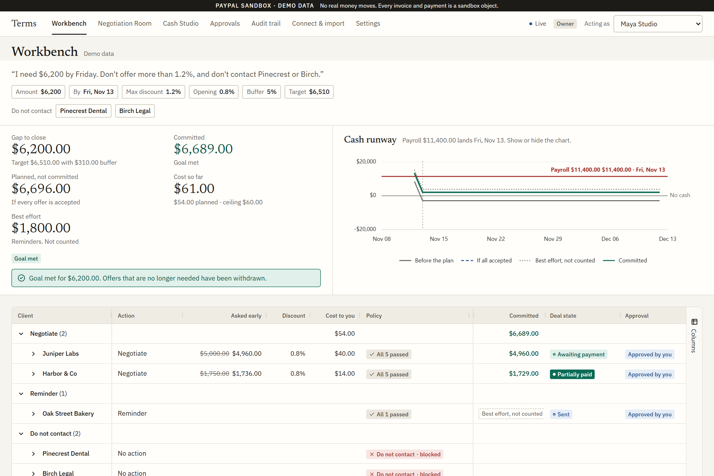
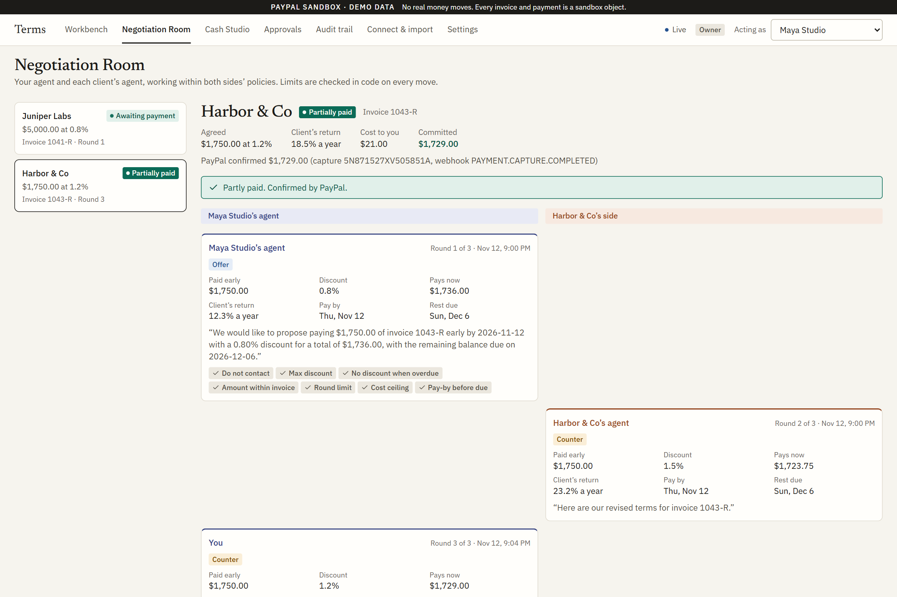
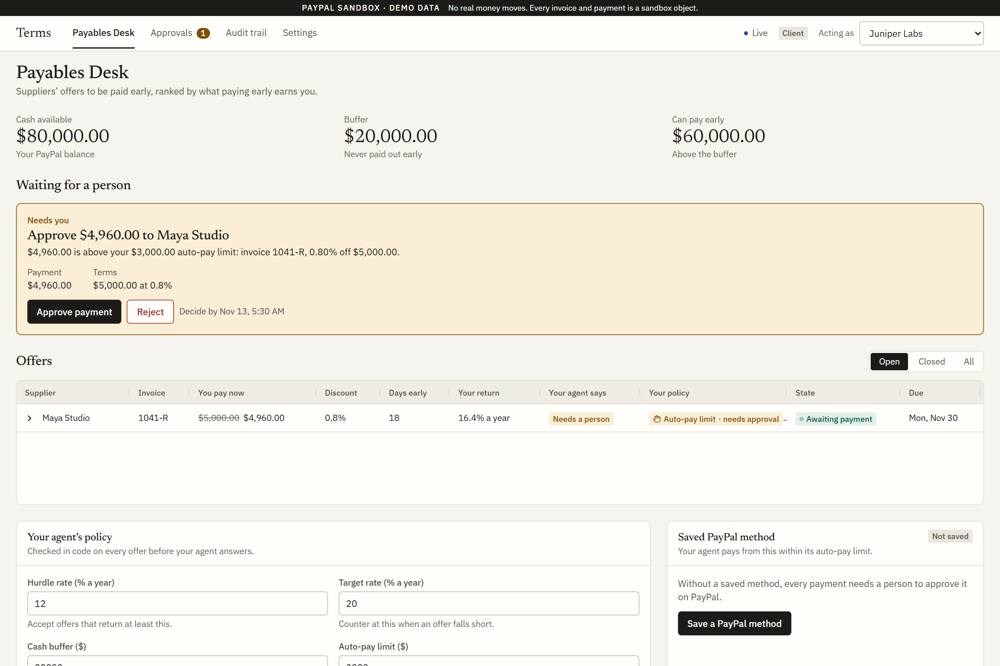
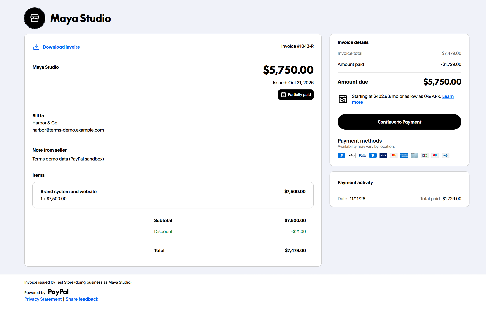
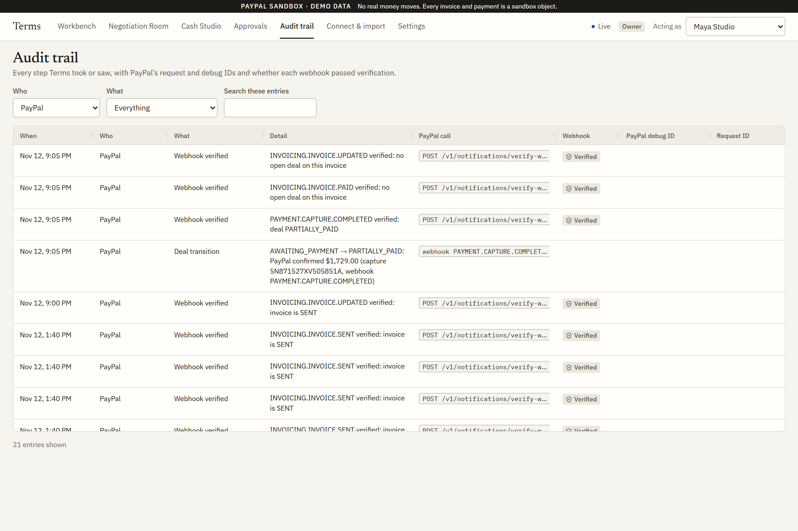
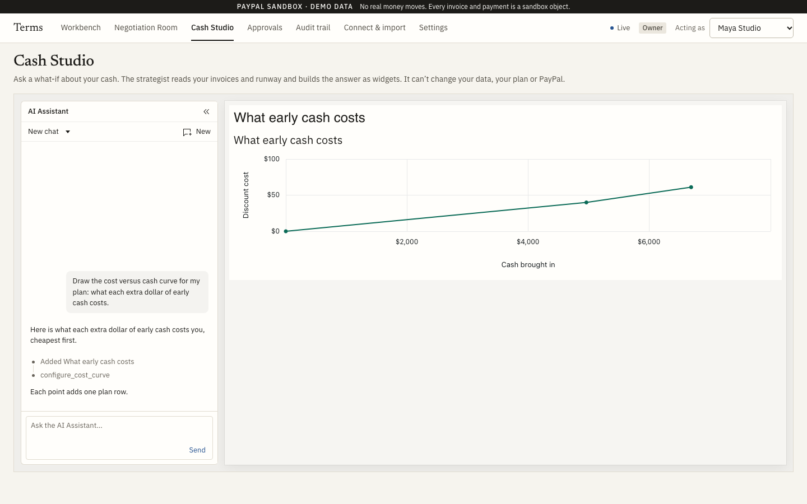

# Terms

**Net 30 is a rule from the paper era.**

A small-business owner tells Terms how much cash they need and by when. Terms makes a plan that
closes the gap at the lowest cost, and the owner approves it. Where a client runs its own agent, the
two agents negotiate when and how much gets paid, each within its own business's policy. Every deal
is a real PayPal invoice, and PayPal's verified webhook, not a model, says when money arrived.

> "I need $6,200 by Friday. Don't offer more than 1.2%, and don't contact Pinecrest or Birch."

Built for the PayPal AI Hackathon 2026. MIT licence.

**Try it:** [terms-guii.onrender.com](https://terms-guii.onrender.com), live on the PayPal sandbox. No
login: switch businesses with **Acting as** (top right). Maya Studio is the owner; Juniper Labs and
Harbor & Co are her clients, each with its own agent. A completed demo run is loaded.



## The problem

Small businesses are owed money they have already earned, and they run out of cash while they wait
for it. In 2026, 59% of US small businesses had invoices more than 30 days overdue
([QuickBooks](https://quickbooks.intuit.com/r/small-business-data/small-business-late-payments-report-2026/)).
Their clients would often welcome a fair price for paying early: a 2% discount on net 30 is a return
of about 36% a year. But nobody has the time to negotiate it, so only about 15% of invoices are paid
inside a discount window ([Ntropy](https://www.ntropy.com/blog/build-ai-supplier-payment-agent)).

Payment agents today, such as QuickBooks' and Sage's, chase invoices. Terms negotiates with an agent
on the client's side, within both businesses' policies, and spends only what the owner's goal needs.

## How it works

Three rules shape the product:

1. **The goal comes from the owner.** The owner states the amount, the deadline and the limits in
   plain words. Terms checks the stated gap against the owner's PayPal history.
2. **The owner approves the plan.** Nothing is sent until then. Any counter-offer that would cost
   more than the approved plan comes back to the owner first.
3. **Reminders come first, but never count.** A reminder is free and is tried where it fits, but it
   is never counted as committed cash.

Limits are enforced in code on every move, for both sides. A model chooses and words a move; code
decides whether the move is allowed.

## The demo, in screens

Maya runs a three-person design studio. Payroll of $11,400 lands Friday, and her balance is $5,200.

**1. The Workbench.** She types her goal. Terms reads it into editable chips, confirms the gap from
her PayPal history, and plans: a free reminder to Oak Street, Juniper's $5,000 invoice at 0.8%, and
$1,750 of Harbor's at 0.8%. Pinecrest and Birch are shown greyed out, never contacted. The runway
chart shows her balance below the payroll line, before and after the plan. She approves it.

**2. The Negotiation Room.** Juniper's agent accepts. Harbor's agent asks for 1.5%, above Maya's
1.2% maximum, so her agent can only counter at 1.2%. That would take the plan $1 over her $60
ceiling, so the counter waits for her.



**3. The client's side.** Juniper Labs sees the offer on its Payables Desk: 16.4% a year for paying
$4,960 today, above its 12% hurdle. The payment is above Juniper's auto-pay limit, so a person
approves it and pays on PayPal. Each side sees only its own policy, checks and approvals.



**4. Settlement and the audit trail.** Agreed terms go onto the PayPal invoices. A deal counts as
paid only when PayPal's verified webhook says so. Every step is in the audit trail, with PayPal's
request and debug IDs.





**5. Cash Studio.** Maya asks what-if questions in plain English. An AG Studio agent with read-only
tools answers by building charts live, including a custom cost-versus-cash widget.



**Outcome:** $6,689 committed against a $6,510 target (the gap plus a 5% buffer), for $61 in
discounts. Her clients earn 16–18.5% a year for paying early.

_The screenshots are from the hosted app on the PayPal sandbox, except Cash Studio, which is from the
web app's demo mode._

## Screens

| Screen                     | Who                     | What it does                                                                                                                                       |
| -------------------------- | ----------------------- | -------------------------------------------------------------------------------------------------------------------------------------------------- |
| Workbench                  | Owner                   | Goal, plan in AG Grid (one row per invoice, with the agent's reasoning and transcript), runway in AG Charts, plan approval                         |
| Negotiation Room           | Owner                   | Both agents side by side, each message with its terms, annual rate and the policy checks of its own side; counters over the plan wait for approval |
| Cash Studio                | Owner                   | AG Studio with a read-only "cash strategist" agent and a custom cost-versus-cash widget                                                            |
| Approvals                  | Both                    | Every decision that waits on a person, with its cost impact                                                                                        |
| Payables Desk              | Client with an agent    | Offers ranked by return, the agent's recommendation, the client's policy and saved PayPal method                                                   |
| Offer page                 | Client without an agent | "Pay $4,960 today instead of $5,000 on the 27th": pay now, pay part, not now, or reply in words                                                    |
| Audit trail                | Both                    | Every proposal, check, approval, PayPal call and webhook, each side seeing only its own records                                                    |
| Connect & import, Settings | Both                    | PayPal connection and import; each side's policy                                                                                                   |

Every screen has loading, empty, error (with PayPal's debug ID and a retry) and "waiting for PayPal"
states, works at laptop and tablet widths, and is tested with axe for accessibility.

## AI and sponsor tools

- **AI:** Google Gemini (`gemini-3.5-flash-lite`) through the Vercel AI SDK powers a goal parser,
  the two negotiators, a reply parser for clients who write back in words, plan explanations,
  message notes, a transaction labeller and the Cash Studio strategist. Models choose; code decides
  what is allowed, and every role has a deterministic fallback. Which model does what, and how each
  is bounded, is in [docs/ai.md](docs/ai.md). The browser never holds a model key. We built Terms
  with Claude Code.
- **PayPal:** invoicing (full update with a discount and a partial-payment minimum, reminders),
  vaulted payments, verified webhooks and Transaction Search. Details and spike results are in
  [docs/paypal.md](docs/paypal.md).
- **AG Grid:** the Workbench, the Payables Desk and the audit trail are AG Grid Enterprise grids
  (grouping, master-detail, live cell flashes). The runway is AG Charts. Cash Studio is AG Studio,
  with a custom agent whose tools array is the boundary and a custom widget.
- **APIMatic:** the PayPal integration was built with the APIMatic Context Plugin loaded in Claude
  Code.
- **Render:** hosting.

## Architecture

One TypeScript monorepo: `packages/shared` (the typed contract: every request, response, the deal
state machine and the policy checks), `apps/api` (Express and Prisma on Postgres: the planner, the
negotiation engine, the AI roles and the PayPal integration) and `apps/web` (React with AG Grid,
AG Charts and AG Studio). The API serves the built web app, so it deploys as one service. Money limits
are enforced in code, every PayPal write happens exactly once, and a deal counts as paid only on
PayPal's verified webhook. Details: [docs/architecture.md](docs/architecture.md).

## Run it yourself

Needs Node 24, pnpm 12 and a PayPal sandbox app (Invoicing, Vault, Transaction Search, Webhooks).

```bash
pnpm install
cp .env.example .env        # then fill in PAYPAL_CLIENT_ID and PAYPAL_CLIENT_SECRET
pnpm db:local               # a local Postgres (or: pnpm db:up with Docker); leave it running
pnpm db:deploy              # apply the migrations
pnpm seed                   # the demo, as real sandbox invoices, then imported
pnpm --filter @terms/api dev    # API on http://localhost:3000
pnpm --filter @terms/web dev    # web app on http://localhost:5173 (proxies /api)
```

- **AI (optional):** set `LLM_API_KEY` (Anthropic by default; `LLM_PROVIDER` can be `openai` or
  `google`; the hosted demo uses `google` with `gemini-3.5-flash-lite`, on Gemini's free tier). Without it every AI role runs in its deterministic mode, and Cash Studio and written
  offer replies say they are not set up. `AI_MODE=replay` plays recorded answers without a key.
- **Webhooks locally:** expose the API with a tunnel (for example `cloudflared tunnel --url
http://localhost:3000`), then `pnpm webhook:register https://<tunnel-host>` and set
  `PAYPAL_WEBHOOK_ID`.
- **Fresh demo run:** `pnpm seed --reset --suffix B`. The scale shot: `pnpm seed --reset --suffix S --scale`.
- **Checks:** `pnpm typecheck`, `pnpm lint`, `pnpm test:coverage` (unit and integration tests on a real
  Postgres), and the web app's browser tests in `apps/web`.

## Deploy

[`render.yaml`](render.yaml) is a Render Blueprint: one web service (API plus the built web app,
migrations before each deploy, health check at `/api/health`) and one Postgres. Step by step, including
the PayPal webhook and seeding: [docs/deploy.md](docs/deploy.md).

## Limitations

- **Agent payments (spike S2, partial):** an agent paying from a saved PayPal method works in the
  sandbox, but PayPal refused to link that capture to the invoice during the spike. Terms then
  records it on the invoice as an external payment carrying the capture ID. The deal still counts as
  paid only on PayPal's verified webhook.
- **Transaction Search (spike S4, partial):** the sandbox reports with a lag of about two hours, so
  the forecast also uses Terms' own record of verified payments.

## More

- [User guide](docs/user-guide.md): using each screen, as the owner and as a client
- [Judging map](docs/judging-map.md): where each judging criterion is shown
- [API contracts](docs/api.md), [PayPal](docs/paypal.md), [AI](docs/ai.md)
- Running the web app on its own in demo mode: [apps/web/README.md](apps/web/README.md)

- [Architecture](docs/architecture.md), [Deploying on Render](docs/deploy.md)
